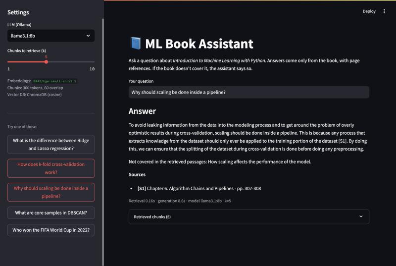
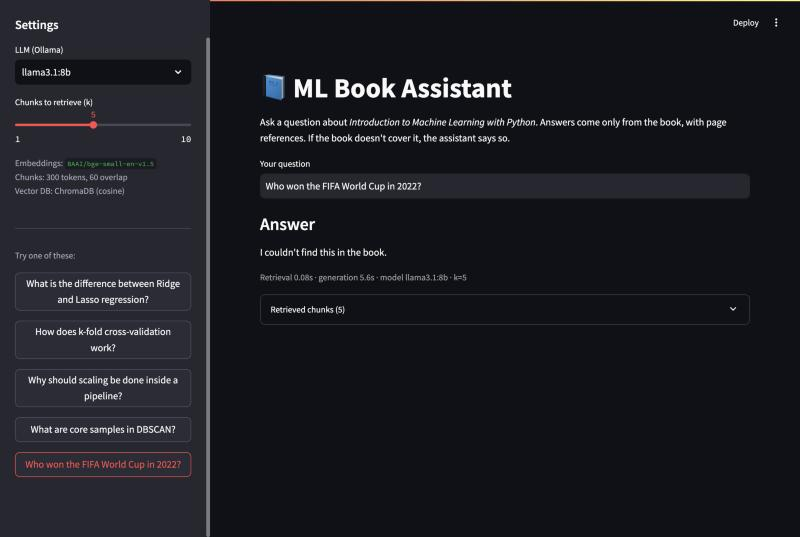

# RAG: Machine Learning Knowledge Assistant

A question-answering assistant over a machine learning book, built with Retrieval-Augmented Generation. You ask a question, it finds the relevant passages in the book and answers from them, with page references. If the book doesn't cover the question, it says so instead of making something up.

**Book:** *Introduction to Machine Learning with Python* by Andreas C. Müller & Sarah Guido (O'Reilly). The PDF is **not included** because it's copyrighted. Put your own copy in this folder as `intro-to-ml-book.pdf`.

Everything runs **locally**. There are no API keys, and no book text is sent anywhere.

<p float="left">
  
  
</p>

## How it works

```
PDF ──► extract + clean ──► chunk (300 tokens, 60 overlap) ──► embed (bge-small) ──► ChromaDB
                                                                                        │
question ──► embed ──► top-k similar chunks ────────────────────────────────────────────┘
                              │
                              ▼
               grounded prompt + llama3.1:8b (Ollama) ──► answer with [S#] citations → pages
```

| Step | What I used | Why |
|---|---|---|
| PDF loading | `pypdf` | Text-based PDF, so it extracts cleanly; no OCR needed |
| Cleaning | Custom (`rag/loader.py`) | Removes running footers (keeping the printed page number), fixes hyphenated line breaks, replaces `In[12]:` prompts, drops the TOC and index pages |
| Chunking | Token sliding window, per chapter | Every chunk knows its pages, which makes the citations possible |
| Embeddings | `BAAI/bge-small-en-v1.5` (SentenceTransformers) | Small, fast, built for retrieval, 512-token input |
| Vector DB | ChromaDB, persistent, cosine | Stores vectors, text and metadata together |
| LLM | `llama3.1:8b` via Ollama | Free, local, good enough to follow grounding rules |
| App | Streamlit | Streams answers, shows sources and the retrieved chunks |

## Results

I made a 16-question test set where I know which passage answers each question, and measured whether retrieval finds it.

**Chunk size (bge-small):**

| Chunk / overlap | Chunks | Hit@3 | Hit@5 | Hit@7 | MRR |
|---|---|---|---|---|---|
| **300 / 60** | 624 | **0.94** | **1.00** | **1.00** | **0.88** |
| 400 / 80 | 468 | 0.94 | 0.94 | 0.94 | 0.84 |
| 500 / 100 | 375 | 0.81 | 0.94 | 0.94 | 0.81 |
| 800 / 150 | 232 | 0.75 | 0.81 | 0.81 | 0.73 |
| 1000 / 150 | 178 | 0.94 | 0.94 | 0.94 | 0.87 |

The main finding is that **smaller chunks worked better**, mainly because the embedding model only reads 512 tokens. With 800–1000-token chunks, a third or more of each chunk is never embedded at all. I went with **300 / 60 and k = 5**. The full reasoning, the embedding-model comparison and the k experiment are in the notebook.

**Grounding:** every answer cites `[S#]` excerpts that map to real pages, and questions outside the book ("Who won the 2022 World Cup?", "How does self-attention in transformers work?") are refused with *"I couldn't find this in the book."*, even though the LLM obviously knows those answers.

## Project structure

```
├── RAG_ML_Knowledge_Assistant.ipynb   # Parts 1-5: exploration, experiments, sample answers (executed)
├── app.py                             # Streamlit app (Part 5)
├── rag/
│   ├── config.py      # all settings in one place
│   ├── loader.py      # PDF loading + cleaning
│   ├── chunker.py     # token-based chunking with page tracking
│   ├── store.py       # embeddings + ChromaDB + similarity search
│   ├── generator.py   # grounded prompt + Ollama
│   ├── pipeline.py    # ties it together (RAGPipeline.ask)
│   └── evaluate.py    # retrieval test set, hit rate, MRR
├── images/            # app screenshots
└── requirements.txt
```

## How to run

1. Install the Python packages:
   ```bash
   pip install -r requirements.txt
   ```
2. Install [Ollama](https://ollama.com) and pull the model:
   ```bash
   ollama pull llama3.1:8b
   ```
3. Copy your PDF of the book into this folder as `intro-to-ml-book.pdf`.
4. Start the app. The first start builds the vector index, which takes about 15 seconds:
   ```bash
   streamlit run app.py
   ```

Or open `RAG_ML_Knowledge_Assistant.ipynb` to go through each part step by step.

Quick use from Python:

```python
from rag import RAGPipeline

rag = RAGPipeline()
rag.ensure_index()
answer = rag.ask("What is the difference between Ridge and Lasso regression?")
print(answer.answer)
print([h.page_label for h in answer.sources])
```

## Limitations

- The test set is small (16 questions), so treat the numbers as indicative.
- Figures aren't used, only their captions.
- The 8B model doesn't cite every single sentence, and often adds a "Not covered…" line even when the answer is complete.
- Pure vector search can miss exact names like `make_pipeline`. Hybrid search (BM25 + vectors) or a re-ranker would be the next improvements.
